<!-- Please do not change this html logo with link -->
​
<a target="_blank" href="https://www.microchip.com/" id="top-of-page">
   <picture>
      <source media="(prefers-color-scheme: light)" srcset="images/mchp_logo_light.png" width="350">
      <source media="(prefers-color-scheme: dark)" srcset="images/mchp_logo_dark.png" width="350">
      
   </picture>
</a>

# Zero-Software Ultrasonic Distance Sensing — Use Case for Configurable Logic Block (CLB) Using the PIC16F13145 Microcontroller with MCC Melody

This repository creates a rangefinder using the HC-SR04+ ultrasonic sensor and displays the results on the eight LEDs bar-graph featured on the Curiosity Nano Explorer Board.

The CLB peripheral is a collection of logic elements that can be configured to implement discrete logic function(s). The logic function may be completely combinatorial, sequential or a combination of the two, enabling users to incorporate hardware-based custom logic into their applications. 

The HC-SR04+ is a standard ultrasonic sensor that can be used for object detection and distance sensing. This is accomplished by the transmitter sending a signal, and then calculating distance based on the time it took the signal to get back to the receiver. The HC-SR04+, unlike the older version, is compatible with both 5V and 3.3V devices.

In this example, the CLB interprets the HC-SR04+ sensor data and displays it on eight LEDs. This removes the need for the user to write any executable code.

## Related Documentation

More details and code examples on the PIC16F13145 can be found at the following links:

- [PIC16F13145 Product Page](https://www.microchip.com/en-us/product/PIC16F13145?utm_source=GitHub&utm_medium=TextLink&utm_campaign=MCU8_PIC16F13145&utm_content=pic16f13145-cnano-ultrasonic-distance-sensor-mplab-mcc-github&utm_bu=MCU08)
- [PIC16F13145 Code Examples on Discover](https://mplab-discover.microchip.com/v2?dsl=PIC16F13145)
- [PIC16F13145 Code Examples on GitHub](https://github.com/microchip-pic-avr-examples/?q=PIC16F13145)

## Software Used

- [MPLAB X IDE v6.30 or newer](https://www.microchip.com/en-us/tools-resources/develop/mplab-x-ide?utm_source=GitHub&utm_medium=TextLink&utm_campaign=MCU8_PIC16F13145&utm_content=pic16f13145-cnano-ultrasonic-distance-sensor-mplab-mcc-github&utm_bu=MCU08) or [MPLAB® Tools for VS Code®](https://www.microchip.com/en-us/tools-resources/develop/mplab-tools-vs-code?utm_source=GitHub&utm_medium=TextLink&utm_campaign=MCU8_PIC16F13145&utm_content=pic16f13145-cnano-ultrasonic-distance-sensor-mplab-mcc-github&utm_bu=MCU08)
- [MPLAB® XC8 v3.10 or newer](https://www.microchip.com/en-us/tools-resources/develop/mplab-xc-compilers?utm_source=GitHub&utm_medium=TextLink&utm_campaign=MCU8_PIC16F13145&utm_content=pic16f13145-cnano-ultrasonic-distance-sensor-mplab-mcc-github&utm_bu=MCU08)
- [PIC16F1xxxx_DFP v1.29.444 or newer](https://packs.download.microchip.com/)

**Important:** The current version features an update to the CLB peripheral, which now includes the CLB Synthesizer Library. For migration details and required changes, refer to the [_Troubleshooting MCC Melody Configurable Logic Block (CLB) Projects Configured With CLB v1.x.x_](https://onlinedocs.microchip.com/oxy/GUID-9438FEC3-C80B-4328-8A8E-2531EDEE6155-en-US-1/index.html) migration guide documentation.

## Hardware Used

- [PIC16F13145 Curiosity Nano Development Board](https://www.microchip.com/en-us/development-tool/EV06M52A?utm_source=GitHub&utm_medium=TextLink&utm_campaign=MCU8_Apps_PIC16F13145&utm_content=pic16f13145-cnano-ultrasonic-distance-sensor-mplab-mcc&utm_bu=MCU08)
  <br>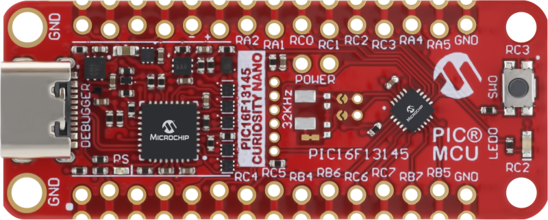

- [Curiosity Nano Explorer Board](https://www.microchip.com/en-us/development-tool/ev58g97a?utm_source=GitHub&utm_medium=TextLink&utm_campaign=MCU8_Apps_PIC16F13145&utm_content=pic16f13145-cnano-ultrasonic-distance-sensor-mplab-mcc&utm_bu=MCU08)
  <br>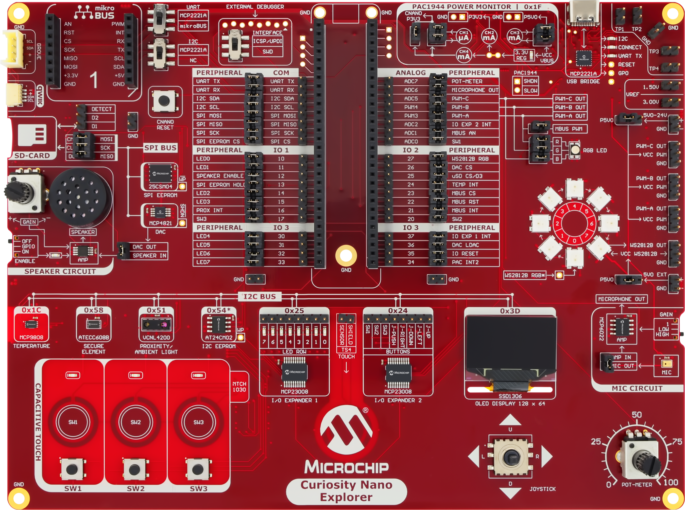

- HC-SR04+ Ultrasonic Distance Sensor
  <br>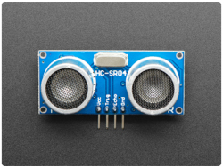

## Operation

To program the Curiosity Nano board with this MPLAB® X project, follow the steps provided in the [How to Program the Curiosity Nano Board](#how-to-program-the-curiosity-nano-board) chapter.<br>

## Concept

The HC-SR04+ sensor works by sending a series of pulses after the trigger pin has been toggled. These pulses travel until they reach an object, are reflected back to the source. If the object is too far away, the sensor will not properly receive the pulse. The distance traveled is based on the length of time the Echo pin is kept high. By measuring the pulse width of the Echo pin, the CLB can determine the distance to the object.

<br>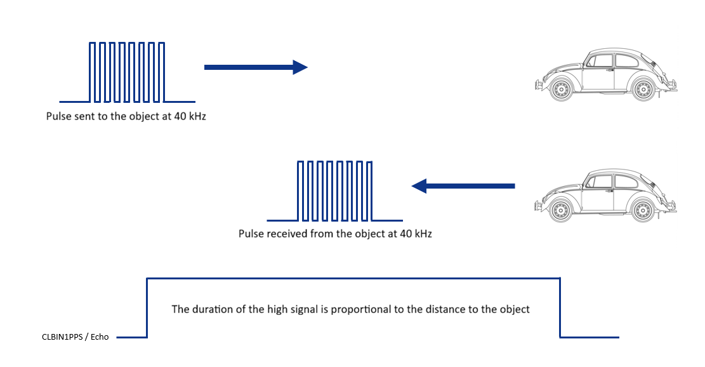

To measure the pulse width, the Timer0 overflow and the internal CLB counter determine which bin the distance falls into.

<br>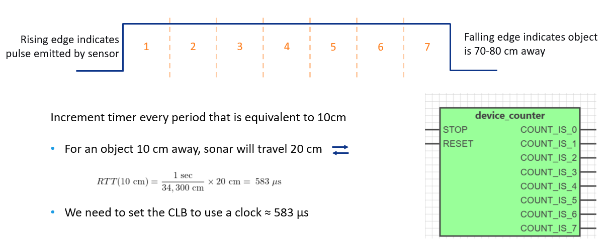

In the PIC16F13145 family of microcontrollers (MCUs), the CLB consists of a series of 32 Look-up Tables (LUTs), similiar to an FPGA. To configure the logic, use the CLB Synthesizer tool inside the MPLAB Code Configurator (MCC).

This project provides two configurations of the CLB: single or all LEDs drive based on the detected object's distance. To program the Curiosity Nano Board with one design or the other, use the Load Design option from the CLB Synthesizer Library and choose between `ultrasonic_led_select.clb` or `ultrasonic_led_all_counts.clb` files. Alternatively, the designs can be drawn from scratch following the images and instructions below.

1. Single LED drive configuration:
   - Add the following submodule named `led_select` within a `New Schematic` by clicking on the Documents menu button in the CLB Synthesizer Library user interface.
   <br>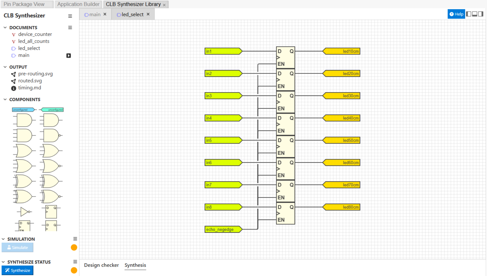
   - In the `main` module, add the previously created submodule and a `device_counter` from the Modules section. The final design needs to look as below:
   <br>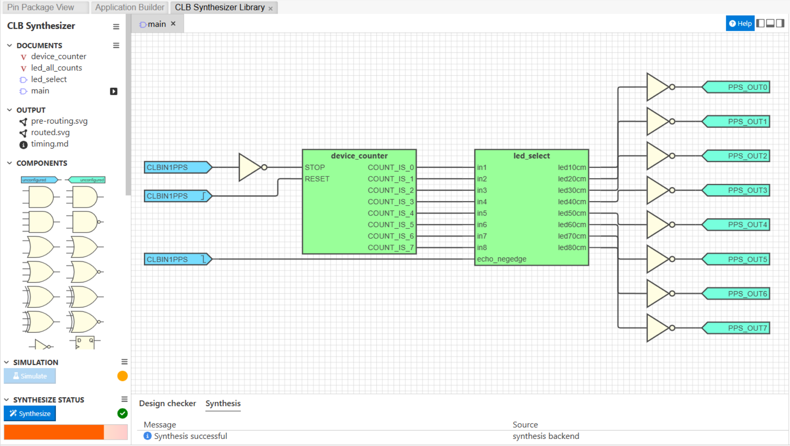

2. All LEDs drive configuration:
   - Add the following submodule named `led_all_counts` within a `New Verilog` by clicking on the Documents menu button in the CLB Synthesizer Library user interface.
        ```
        module led_all_counts(in1, in2, in3, in4, in5, in6, in7, in8, led10cm, led20cm, led30cm, led40cm, led50cm, led60cm, led70cm, led80cm);
        input in1, in2, in3, in4, in5, in6, in7, in8;
        output led10cm, led20cm, led30cm, led40cm, led50cm, led60cm, led70cm, led80cm;

        assign led10cm = in1 | in2 | in3 | in4 | in5 | in6 | in7 | in8;
        assign led20cm = in2 | in3 | in4 | in5 | in6 | in7 | in8;
        assign led30cm = in3 | in4 | in5 | in6 | in7 | in8;
        assign led40cm = in4 | in5 | in6 | in7 | in8;
        assign led50cm = in5 | in6 | in7 | in8;
        assign led60cm = in6 | in7 | in8;
        assign led70cm = in7 | in8;
        assign led80cm = in8;
        endmodule
        ```
     <br>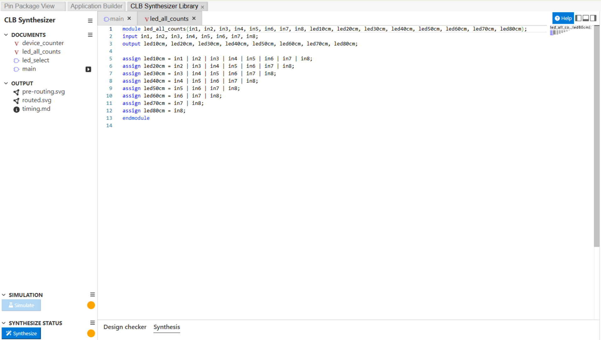
   - In the `main` module, add the previously created submodule and a `device_counter` from the Modules section. The final design needs to look as below:
     <br>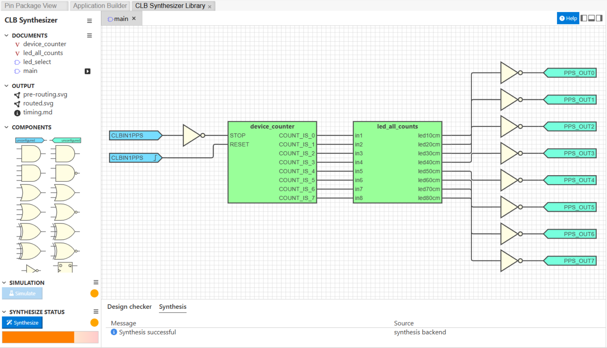


**Note:** Any changes in the CLB Synthesizer Library user interface will have to be synthesized before generating the files needed for programming.

## Setup

The following peripheral and clock configurations are set up using the MPLAB® Code Configurator (MCC) Melody for the PIC16F13145:

- Configuration Bits:
  - External Oscillator mode selection bits: Oscillator not enabled
  - Power-up default value for COSC bits: HFINTOSC (1 MHz)
  - Brown-out reset enable bits: Brown-out reset disabled
  - WDT operating mode: WDT Disabled, SEN is ignored
  <br>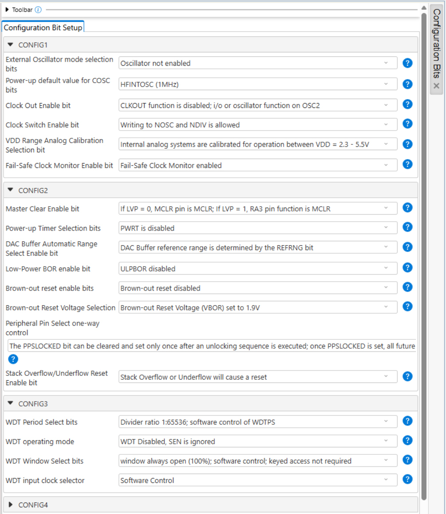

- Clock Control:
  - Clock Source: LFINTOSC
  <br>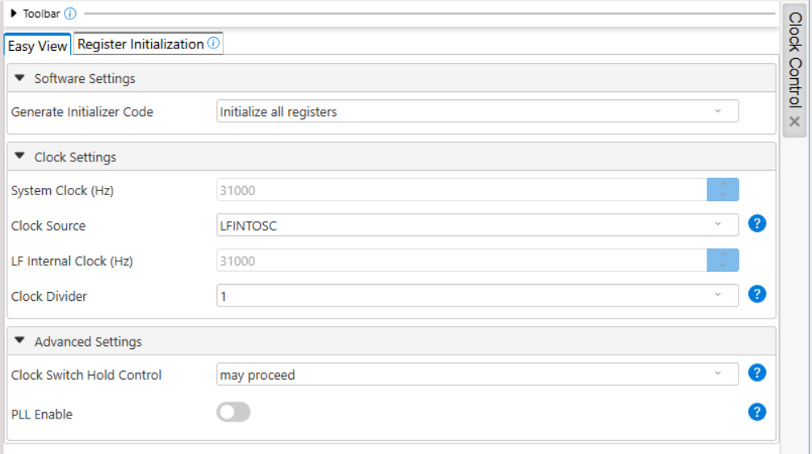

- Interrupt Manager:
  - Enable Single ISR Execution per entry: Enabled
  <br>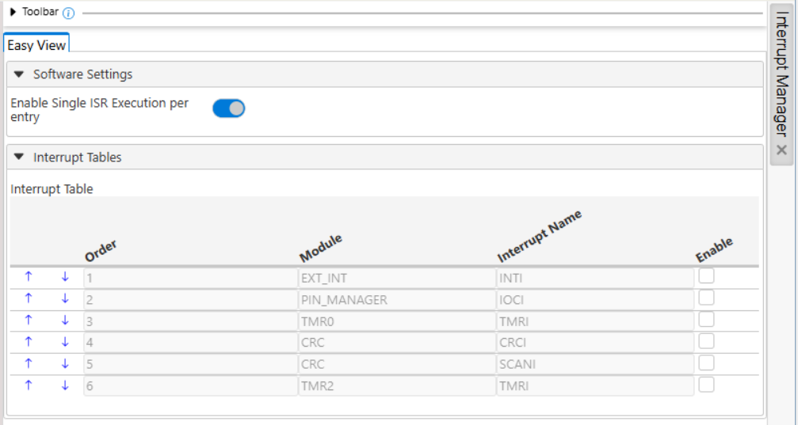 

- TMR2:
  - Clock Source: FOSC/4
  - Clock Synchronization: Enabled
  - Prescalar: 1:128
  - Postscalar: 1:16
  - Time Period (s): 0.9
  <br>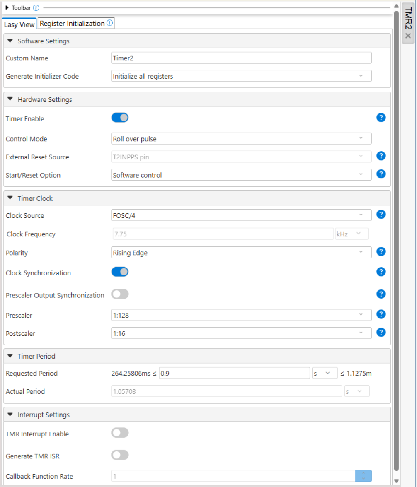

- PWM1:
  - Timer Dependency Selector: Timer2
  - Duty Cycle (%): 10
  <br>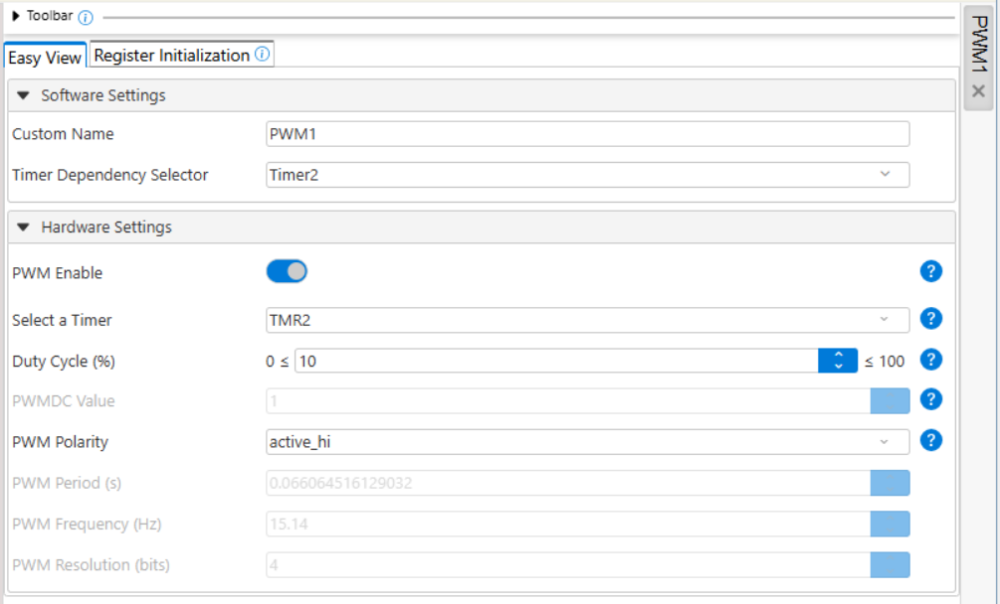

- TMR0:
  - Timer Mode: 8-bit
  - Clock Prescaler: 1:128
  - Clock Source: HFINTOSC 
  - Requested Period (s): 0.000584 
  <br>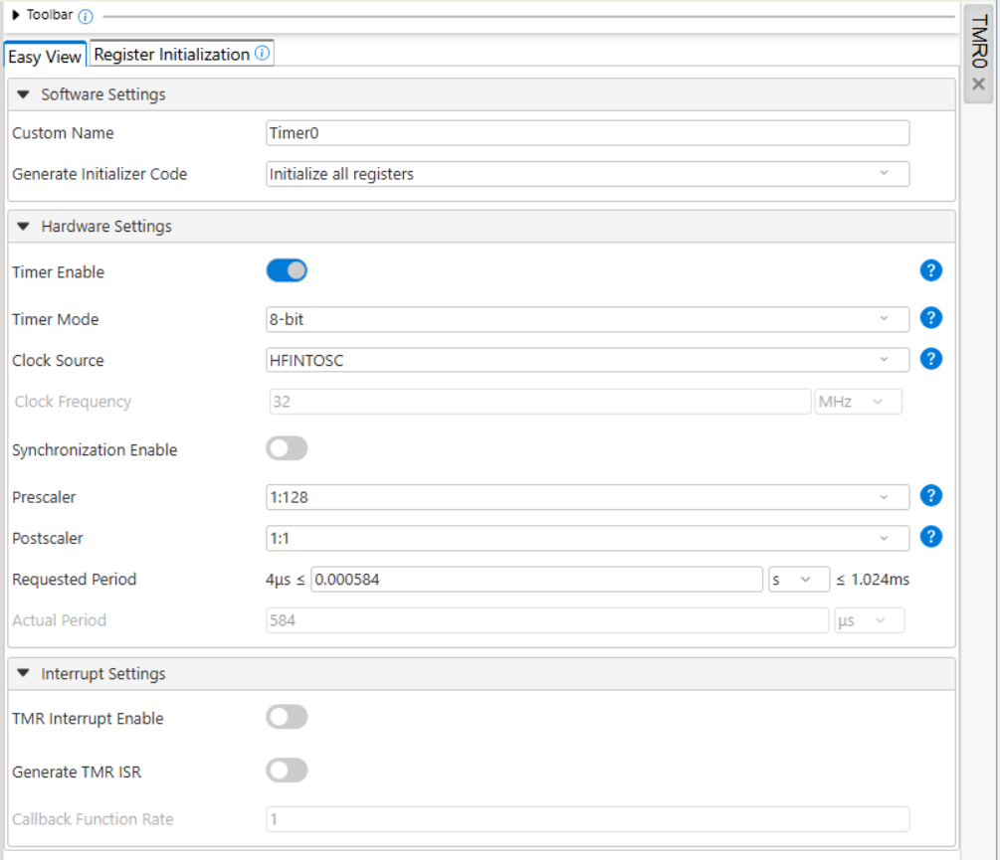

- CLB Synthesizer Library:
  - Clock Divider: Divide clock source by 1
  - Clock Selection: TMR0_Overflow
  <br>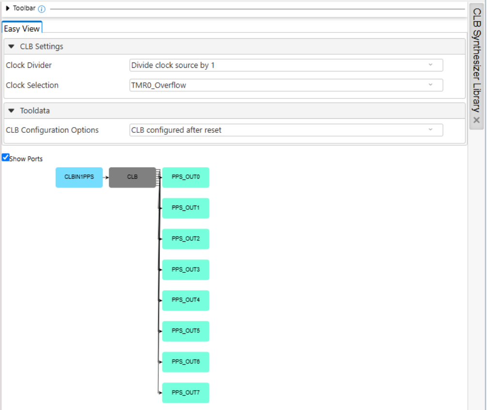

- CLB1:
  -  Enable CLB: Enabled
  <br>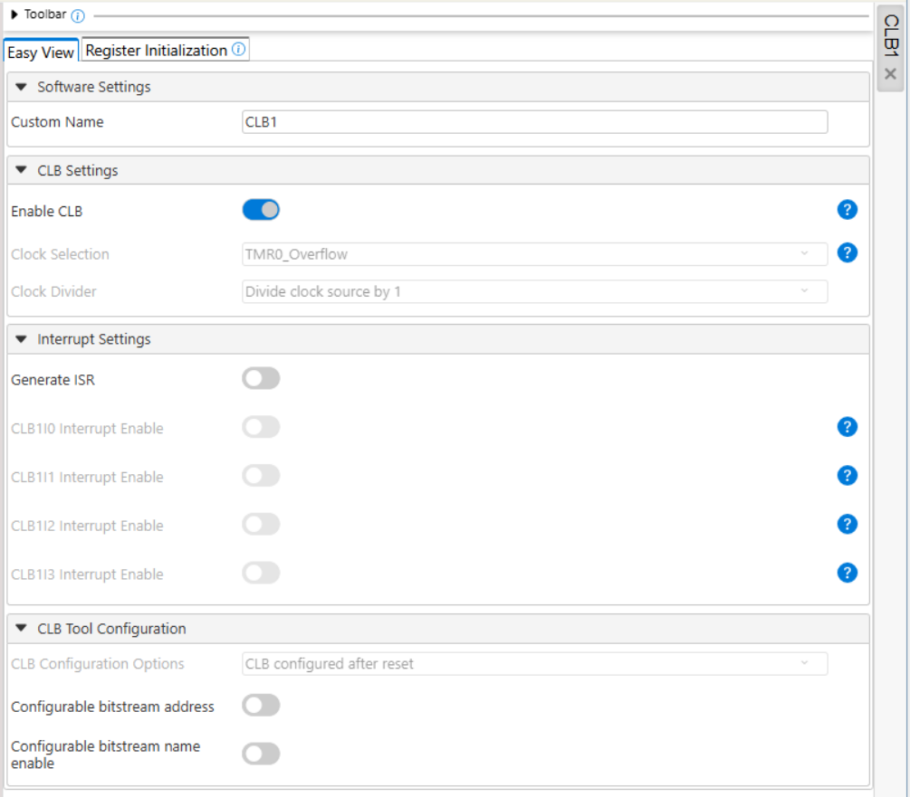

- CRC:
  - Auto-Configured by CLB

- Pin Grid View
  - CLBPPSOUT0: RA5 (Closest Indicating LED)
  - CLBPPSOUT1: RA4
  - CLBPPSOUT2: RC3
  - CLBPPSOUT3: RC2
  - CLBPPSOUT4: RC1
  - CLBPPSOUT5: RC0
  - CLBPPSOUT6: RA1
  - CLBPPSOUT7: RA2 (Furthest Indicating LED)
  - CLBIN1PPS: RC4 (Echo Pin for HC-SR04+)
  - PWM1OUT: RC5 (Trig Pin for HC-SR04+)
  <br>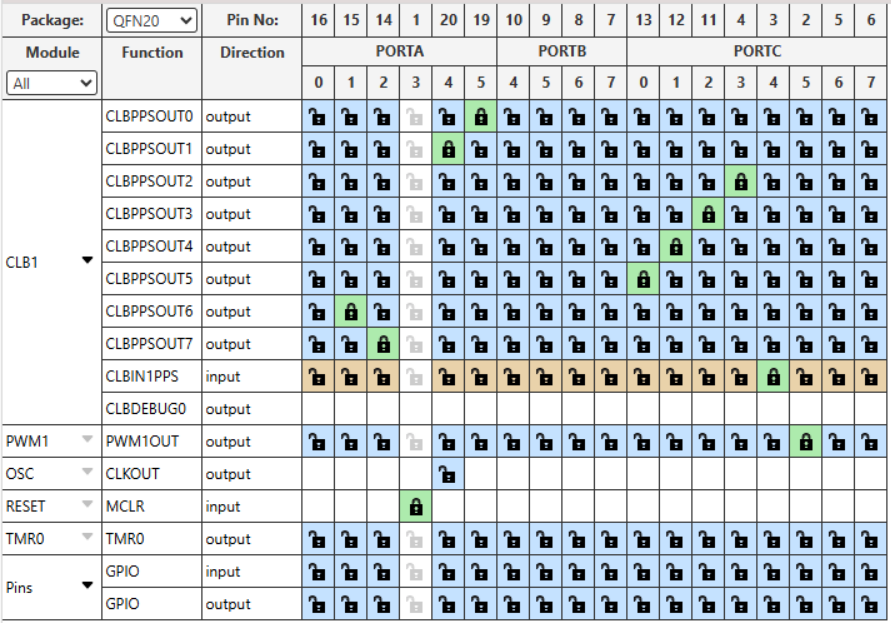
  <br>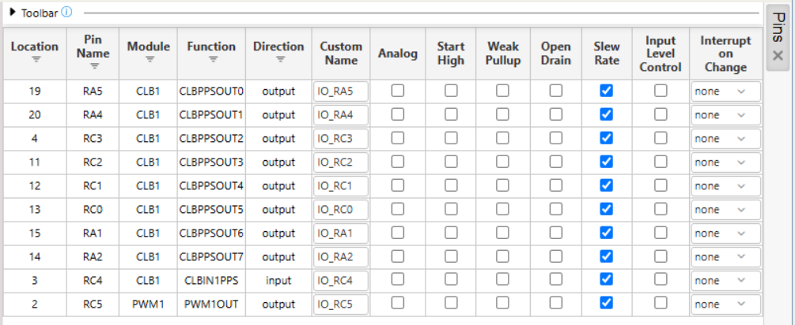

## Demo

### All LEDs Drive

  <br>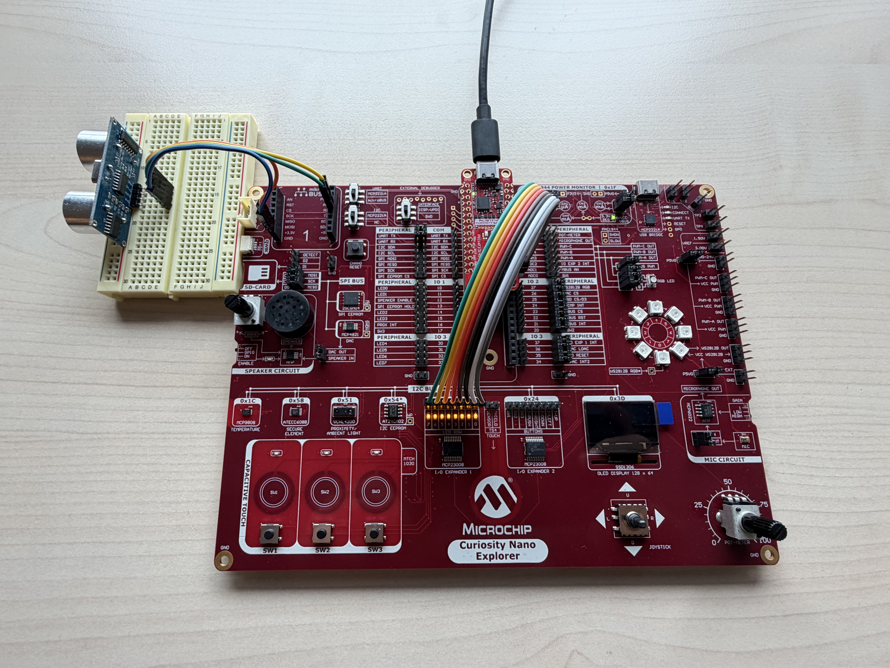
  <br> 

This demonstration shows the PIC16F13145 with a CLB configuration using Verilog and the internal counter to keep every LED below the measured value HIGH while running.

### Single LED Drive

  <br> 

This demonstration shows the PIC16F13145 with a CLB configuration using logic gates and the internal counter to keep only the measured LED HIGH while running.

## Summary

The CLB significantly reduces the software overhead associated with implementing this example. Usually, it is up to the software to handle a timer, counter, as well as the I/Os. These tasks involve managing pin placement (in some cases making sure there is an open row), checking the counter and/or timer is reloaded, or bit-masking. With the CLB, all functions associated with this example are handled by the hardware, which leaves the CPU free to do other tasks without interruption. 

The examples featured above showcase that the CLB is a highly configurable and open-ended tool.

##  How to Program the Curiosity Nano Board 

This chapter demonstrates how to use the MPLAB® X IDE to program a PIC® device with an `Example_Project.X`. This is applicable to other projects.

1.  Connect the board to the PC.

2.  Open the `Example_Project.X` project in MPLAB X IDE.

3.  Set the `Example_Project.X` project as main project.
    <br>Right click the project in the **Projects** tab and click Set as Main Project.
    <br>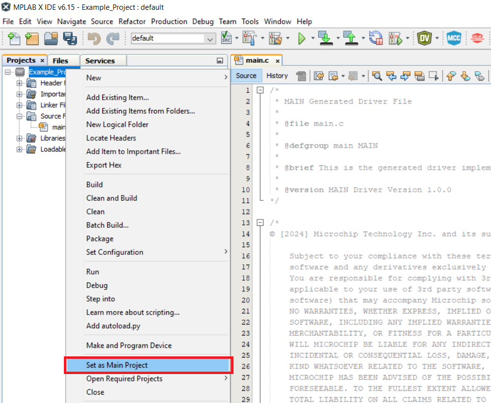

4.  Clean and build the `Example_Project.X` project.
    <br>Right click the `Example_Project.X` project and select Clean and Build.
    <br>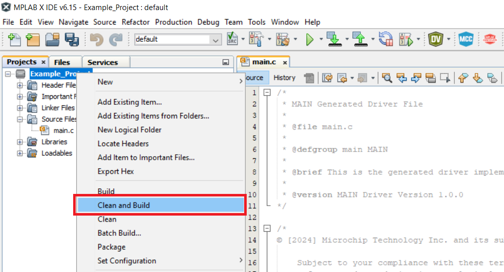

5.  Select PICxxxxx Curiosity Nano in the Connected Hardware Tool section of the project settings:
    <br>Right click the project and click Properties.
    <br>Click the arrow under the Connected Hardware Tool.
    <br>Select PICxxxxx Curiosity Nano by clicking on the SN.
    <br>Click **Apply** and then **OK**.
    <br>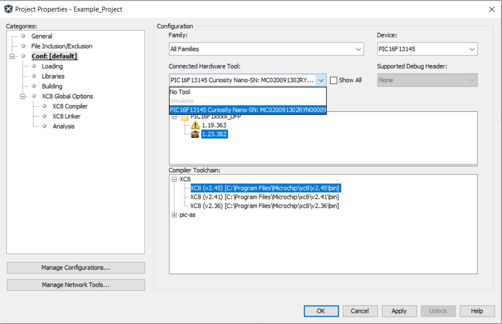

6.  Program the project to the board.
    <br>Right click the project and click Make and Program Device.
    <br>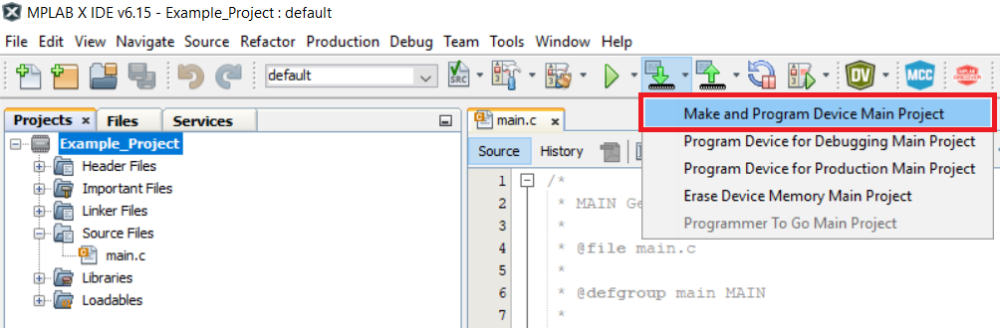

<br>

- - - 
## Menu
- [Back to Top](#zero-software-ultrasonic-distance-sensing--use-case-for-configurable-logic-block-clb-using-the-pic16f13145-microcontroller-with-mcc-melody)
- [Back to Related Documentation](#related-documentation)
- [Back to Software Used](#software-used)
- [Back to Hardware Used](#hardware-used)
- [Back to Operation](#operation)
- [Back to Concept](#concept)
- [Back to Setup](#setup)
- [Back to Demo](#demo)
- [Back to Summary](#summary)
- [Back to How to Program the Curiosity Nano Board](#how-to-program-the-curiosity-nano-board)